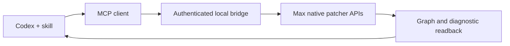

# Max/MSP Bridge for Codex

[](https://github.com/Riyou666/max-msp-bridge/actions/workflows/test.yml)

**Connect Codex to Max/MSP on Windows to inspect, edit, and debug patches through native APIs.**

A local MCP bridge with a companion Codex skill. Supported operations do not require screenshots, mouse control or opening every subpatcher window.

- **Bridge:** connects Codex to a Max patch for native inspection, object creation, wiring, supported edits and background diagnostics.
- **Skill:** guides Codex in planning signal paths, respecting your layout, checking the target, diagnosing problems and keeping supported changes recoverable. The skill provides working instructions; it does not add bridge endpoints.

Keep working in Max, choose your own patch organization, and ask for help where you need it. Take turns when editing the same area.

[Get started](#get-started-with-codex) · [Connect a project](#connect-your-project) · [Examples](#try-it) · [Troubleshooting](#troubleshooting) · [Limitations](#current-limitations)

## Get started with Codex

**Already using Codex? Copy this prompt into your chat:**

```text
Install https://github.com/Riyou666/max-msp-bridge for me.

Read its README and check Windows, Max 9, Node.js 20+ and PowerShell 7.
Find my Max installation and preserve my existing Codex configuration.
If the skill or MCP registration already exists, compare versions and
back it up rather than creating a duplicate or overwriting it blindly.

Install the skill and register the max_windows MCP server. Create a
separate blank bridge-enabled test patch without overwriting my files.
Tell me when I need to open it in Max or reload Codex's MCP connection.

Verify the exact connected file and workspace. In the test workspace,
create a number input -> * 2 -> number output, send 21, and read back 42.
Do not enable audio or modify my existing creative projects.
```

Codex needs local file and command access. It can perform the supported setup steps and identify missing prerequisites. You may need to open the generated patch in Max, reload MCP, or respond to local permission prompts. Sending a link alone does not connect an arbitrary open patch.

**Success looks like:** Codex reports the intended patch's full path, inspects its workspace, and reads back **42**. This verifies control and wiring, not audio output.

### Requirements

| Component | Requirement |
| --- | --- |
| Platform | Windows |
| Max | Max 9 with `v8` and Node for Max |
| Runtime | Node.js 20+ and PowerShell 7 (`node` and `pwsh` on PATH) |
| Client | Codex with MCP support and local file/command access |

Live testing has been performed on Windows x64 with Max 9.2.0 and Node 24.14.1. Other Max versions have not been verified. The bridge requires no separate API key or npm dependencies; normal Codex access is still required.

<details>
<summary>Prefer to install manually? Expand the PowerShell instructions.</summary>

Run in PowerShell 7. Git is needed for the clone command. Replace the Max path with the directory containing your `Max.exe`:

```powershell
git clone https://github.com/Riyou666/max-msp-bridge.git
cd max-msp-bridge
./scripts/install.ps1 -MaxRoot 'E:\Applications\Max 9'
node "$HOME\.codex\skills\max-msp-windows\scripts\prepare-demo.mjs" "$PWD\max-control.maxpat"
```

The installer copies the skill into `$HOME\.codex\skills\max-msp-windows`, backs up an existing Codex config, and adds `mcp_servers.max_windows`. It refuses an existing installation or registration so it can be compared before replacement. It does not change Windows execution policy. The generator refuses to overwrite files.

Open `max-control.maxpat` in Max, reload Codex's MCP connection, and ask Codex to perform the **21 → ×2 → 42** check above. Save in Max to retain live edits.

</details>

## Connect your project

**Install once. Add the bridge to each project you want to control.** You do not need to edit `config.toml` every time or keep the demo open.

### Starting a new project

```text
Use max-msp-windows to create a blank bridge-enabled project at
<full-path-to-new-project.maxpat>. Preserve existing files and leave
audio off. Help me connect it, verify its exact path, and use its
workspace subpatcher as the working area.
```

The destination directory must exist. Open the generated patch when instructed. Save it in Max; reopening that saved project normally starts its bridge automatically.

### Connecting an existing project

```text
Add only the max-msp-windows bridge to <full-path-to-project.maxpat>.
The patch is <open/closed> and has <saved/unsaved> changes.
Check for an existing bridge and make a backup first. Preserve my
objects, connections, layout and audio logic. Never overwrite unsaved
live work from disk; prepare a separate copy if needed. Verify the
connected filepath and scope before making creative changes.
```

The bridge controls its host patch and child scopes. Changing the frontmost Max window does not change that target. Only one bridge can use the default port, `8711`, at a time; stop the old bridge before starting another. Other Max windows may remain open.

For exact manual steps, reopening, sharing and upgrades, see [Project setup and updates](references/project-setup.md).

## Try it

**Diagnose a silent patch**

> Check this project's connection, Console, audio status and signal path. Explain where the sound stops before changing anything.

**Fix one part**

> Connect this player's stereo outputs to the mixer. Preserve the rest of the patch and verify both channels afterward.

**Organize a module**

> Help encapsulate this section as a named subpatcher. Preserve its behavior and keep the internal windows closed while you work; I will double-click it when I want to look inside.

**Keep a project approachable**

> Build the simplest version of this idea first. Give me clearly labeled start, stop and volume controls, and explain what I can adjust.

Requests may combine file preparation and live operations depending on available tools. Codex should explain when an operation is unsupported instead of switching to desktop automation.

## Bridge: native patch control

| Task | Tools |
| --- | --- |
| Verify connections and inspect graphs | `max_status`, `max_inspect` |
| Create, wire, disconnect and move objects | `max_create`, `max_connect`, `max_disconnect`, `max_move` |
| Set values and send supported messages | `max_setvalue`, `max_send` |
| Remove objects created by the current receiver session | `max_remove` |
| Look up installed Max references | `max_reference` |
| Read Console history, exposed preferences and audio settings | `max_console`, `max_preferences`, `max_audio_status` |
| Change explicitly requested supported audio settings | `max_audio_set` |
| Restart the bridge through Max APIs | `max_bridge_restart` |

Unnamed objects can be addressed by runtime IDs. Mutations require a current session and inspection revision; IDs and revisions expire when the receiver reloads. See [Live control](references/live-control.md) for arguments and failure handling.



## Skill: working together

The [skill instructions](SKILL.md) and [artist workflow](references/artist-workflow.md) guide how Codex works:

- **Confirm the target automatically.** Check the session, filepath and scope before editing. If setup needs your help, use a reply card when the client supports it and continue independent checks while waiting.
- **Respect your organization.** Colored groups, subpatchers, nested modules and embedded interfaces are personal choices. Background inspection should not open a stack of internal windows.
- **Keep edits recoverable.** Retain backups or before/after records and supported inverse operations. Preserve later edits when undoing a change. This is a workflow, not a built-in universal undo engine.
- **Keep controls understandable.** Use meaningful labels, units and ranges. New sound-producing patches start muted; audio hardware is not enabled automatically.

Pause your own edits in the area Codex is modifying. Revision checks help detect conflicts but do not provide simultaneous collaborative editing. **Save in Max to persist live changes.**

## Troubleshooting

| Symptom | Next step |
| --- | --- |
| Codex cannot see `max_windows` tools | Confirm installation and reload the MCP connection. |
| Bridge is offline | Confirm the intended host is open and its bridge is started; inspect script paths and port errors. |
| Connection points to the wrong project | Stop the old bridge, start the intended one, and verify `filepath` again. |
| A patch opens but does not connect | Check whether it contains the bridge. Opening an ordinary patch is not enough. |
| A write is rejected | Inspect again and reassess intervening edits; do not blindly replay the write. |
| A request times out | Its outcome may be unknown. Inspect before deciding whether another write is needed. |
| The patch is silent | Check files, player state, routing, gain and audio status. A working bridge does not prove working audio. |
| A shared project cannot find scripts | Bridge paths are machine-specific. Install locally and reconnect or update both script paths. |

While connected, Codex can read the Console in the background. If disconnected, it can still inspect saved files and configuration, but cannot fetch live diagnostics through that connection.

## Current limitations

- No automatic attachment to every open project, unrestricted eval, save endpoint or transactional undo.
- Removal is limited to objects created by the current receiver session. Existing objects cannot be deleted through that endpoint.
- `max_send` supports restricted selectors, not every message understood by every Max object.
- Console history is global and bounded. Preferences reads cover exposed attributes, not every Preferences control.
- Audio setting changes are application-wide. Device selection and arbitrary preference writes are not supported.
- No built-in audio analyzer. JSON validation and graph readback do not establish audible correctness.
- The bridge binds to loopback and uses a per-start token. It is a local same-user service, not a sandbox for arbitrary Max objects or a remote access service.

Unsupported operations are reported explicitly. The skill does not fall back to Computer Use.

## Development and documentation

Run from the repository root:

```powershell
node --test
node scripts/maxpat.mjs validate '<your-patch.maxpat>'
```

The validator checks JSON graph structure, not object availability or DSP behavior. Report structural validation, native readback and audio testing separately.

- [Project setup and updates](references/project-setup.md) — connect, reopen, switch, share and upgrade.
- [Artist workflow](references/artist-workflow.md) — layout choices, wiring, diagnosis and recoverable edits.
- [Live control](references/live-control.md) — scopes, revisions, tools and failure semantics.
- [Windows reference lookup](references/windows.md) — installed documentation and platform paths.
- [Research and provenance](references/research.md) — design sources and implementation boundaries.

For a bug report, include Windows, Max and Node versions, the failing operation, expected behavior, and a minimal patch when possible. Remove bridge tokens, private paths and recordings before sharing. [Open an issue](https://github.com/Riyou666/max-msp-bridge/issues).

Architecture was informed by [MAX-MSP_CC_Framework](https://github.com/taylorbrook/MAX-MSP_CC_Framework), [MaxMCP](https://github.com/signalcompose/MaxMCP) and [tdmcp](https://github.com/Pantani/tdmcp). This repository is an independent implementation.
